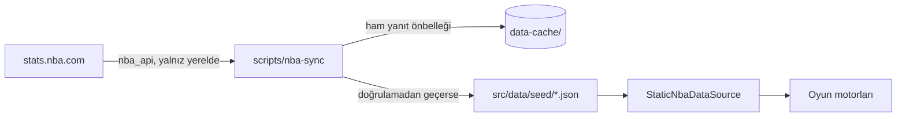
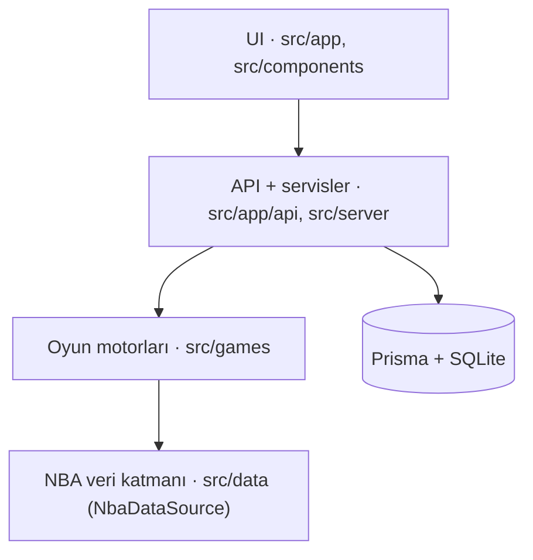

<div align="center">


# NBA Games

**NBA bilgini koçun tahtasında sına.**
Altı bilgi oyunu, her gün yenilenen bir Daily Challenge, streak'ler, rozetler ve liderlik tablosu —
hepsi gerçek NBA istatistiklerinden üretilmiş veriyle.


[Oyunlar](#-oyunlar) · [Nasıl çalışır](#-nasıl-çalışır) · [Kurulum](#-hızlı-başlangıç) · [Komutlar](#-komutlar) · [NBA verisi](#-nba-verisi) · [Mimari](#-mimari) · [Dokümanlar](#-dokümanlar)

</div>

---

## ✨ Öne çıkanlar

- 🏀 **6 oyun modu × 4 zorluk × 2 dönem** — 48 kombinasyonun hepsi gerçek veriyle tam oturum üretir (testle doğrulanır).
- 🕰️ **Current / Retired** — bugünün oyuncuları ya da emekli efsaneler (Jordan, Magic, Bird, Kareem…). Seçim tarayıcıda hatırlanır.
- 📅 **Daily Challenge** — her UTC gününde herkese aynı 5 soru, kişi başına tek deneme, ayrı günlük sıralama.
- 🔥 **Streak, puan, rozetler** — art arda doğrularla bonus, 8 rozet, oyun geçmişi ve profil.
- 🔒 **Hilesiz** — cevap kontrolü, süre ölçümü ve puan hesabı sunucuda; doğru cevap istemciye önceden gitmez.
- 🌍 **Türkçe ve İngilizce** — dil cookie'den ya da tarayıcı dilinden seçilir; oyun modu adları ve istatistik kısaltmaları İngilizce kalır.
- 👤 **Kayıt yok** — ilk ziyarette imzalı cookie ile misafir hesap; liderlik tablosu için yalnızca takma ad.
- 📱 **Mobil öncelikli** — 360 / 768 / 1280 px'te yatay kaydırmasız, klavyeyle tam oynanabilir, `prefers-reduced-motion` uyumlu.

## 🏀 Oyunlar

| Mod | Ekranda ne var? | Ne bulursun? | Kapak (Current / Retired) |
|---|---|---|---|
| **Starting Five** | Bir takımın o sezonki ilk beşinden 4 oyuncu, takım ve sezon | Eksik 5. oyuncu | Curry / Jordan |
| **Team Journey** | Oyuncunun kariyerindeki takımlar, kronolojik sırayla | Oyuncu | LeBron / Shaq |
| **Teammate Challenge** | Aynı takım-sezonda oynadığı 2–5 takım arkadaşı | Ortak oyuncu | Dončić / Magic |
| **Career Stats** | PPG, RPG, APG, SPG, BPG, FG%, maç, sezon, pozisyon | Oyuncu | Jokić / Kareem |
| **Box Score** | Gerçek bir maçtan tek oyuncu satırı + tarih, takımlar, skor | Oyuncu | Giannis / Kobe |
| **Top 10 Challenge** | Bir kariyer istatistiği sıralaması, bazı satırlar gizli | Gizli her sıradaki oyuncu | Durant / Duncan |

Bir oturum 10 sorudur; Top 10 Challenge'da 3 liste oynanır.

## 🎯 Nasıl çalışır

### Zorluklar

| | Easy | Medium | Hard | Expert |
|---|:---:|:---:|:---:|:---:|
| Süre (soru başına) | 30 sn | 25 sn | 20 sn | 20 sn |
| Cevap biçimi | 4 şık | 6 şık | Oyuncu arama | Oyuncu arama |
| Oyuncu havuzu | Yıldızlar | Yıldızlar + rotasyon | Herkes | Herkes |
| Puan çarpanı | ×1.0 | ×1.5 | ×2.0 | ×3.0 |
| Ek kural | — | — | — | İpuçları azalır (ör. sezon yılı, yıl aralıkları, tarih gizlenir) |

Top 10 Challenge'da gizli satır sayısı zorlukla artar (2 → 5) ve liste başına süre 60 sn'dir.

### Puanlama

```text
doğru cevap:  round((100 + süre bonusu) × zorluk çarpanı) + streak bonusu
              süre bonusu   = 0–50, kalan süreyle orantılı
              streak bonusu = 2. art arda doğrudan itibaren +20, en fazla +100
yanlış / süre doldu:  0 puan, streak sıfırlanır
```

> Örnek: Hard, 20 saniyenin 10'u kalmışken, art arda 3. doğru → `round((100 + 25) × 2.0) + 40 = 290`

### Dönemler

| | Current | Retired |
|---|---|---|
| Cevap | Aktif oyuncular | Emekli oyuncular |
| Starting Five | Son 3 sezonun beşlileri | Daha eski beşliler (1996-97 sezonuna kadar) |
| Top 10 | Aktif oyuncular arasındaki kariyer liderleri | All-time listeler, yalnız emekli satırları gizli |

Easy/Medium şıkları aynı dönemden gelir; Hard/Expert aramasında tüm oyuncular çıkar, böylece arama cevabın dönemini ele vermez. Daily Challenge ve liderlik tablosu dönemden bağımsızdır.

### Rozetler

`First Game` · `Perfect 10` · `Streak 5` · `Streak 10` · `Expert Win` · `All Modes` · `Daily 3` · `10K Points`

## 🚀 Hızlı başlangıç

Gerekenler: **Node.js 24+** ve npm. Veriyi yeniden çekmek istersen ayrıca **Python 3.13+**.

```bash
npm install                 # bağımlılıklar + Prisma istemcisi (postinstall)
cp .env.example .env        # sonra SESSION_SECRET'i doldur (aşağıda)
npm run db:migrate          # yerel SQLite veritabanı (dev.db)
npm run dev                 # http://localhost:3000
```

`SESSION_SECRET` üretmek için:

```bash
node -e "console.log(require('crypto').randomBytes(32).toString('hex'))"
```

NBA verisi repoda hazır gelir (`src/data/seed/`); API anahtarı gerekmez.

<details>
<summary><b>Ortam değişkenleri (<code>.env</code>)</b></summary>

| Değişken | Açıklama |
|---|---|
| `DATABASE_URL` | SQLite dosyası, varsayılan `file:./dev.db` |
| `SESSION_SECRET` | Misafir cookie'sini imzalamak için ≥32 bayt rastgele değer |
| `NEXT_PUBLIC_REMOTE_MEDIA` | `true` ise oyuncu fotoğrafları NBA CDN'den yüklenir; `false` ise baş harfli avatar |
| `TRUST_PROXY` | Ters proxy arkasında `true`: rate limit için `X-Forwarded-For` kullanılır |
| `GUEST_LIMIT_PER_HOUR` | İstemci başına saatlik yeni misafir sınırı (varsayılan 10) |

> [!WARNING]
> Yayına alırken proxy arkasında `TRUST_PROXY=true` ayarlanmazsa, cookie'si olmayan tüm ziyaretçiler tek bir misafir kotasını paylaşır.

</details>

## 🧰 Komutlar

| Komut | İş |
|---|---|
| `npm run dev` | Geliştirme sunucusu |
| `npm run build` · `npm start` | Production build ve çalıştırma |
| `npm run lint` · `npm run typecheck` | ESLint · TypeScript kontrolü |
| `npm run format` · `npm run format:check` | Prettier ile biçimlendir · kontrol et |
| `npm test` · `npm run test:watch` | Unit + entegrasyon testleri (Vitest) |
| `npm run test:e2e` | Uçtan uca testler (Playwright; ilk sefer `npx playwright install chromium`) |
| `npm run verify` | **Tam doğrulama:** lint + typecheck + test + veri doğrulama + build |
| `npm run db:migrate` | Prisma migration |
| `npm run db:reset` | Veritabanını sıfırlar — **tüm kullanıcı verisini siler** |
| `npm run data:validate` | Seed verisini şema ve bütünlük kurallarına göre doğrular |
| `npm run data:sync` | NBA API'den veriyi yeniden çeker (aşağıda) |
| `npm run data:test` | Veri hattı (Python) testleri |

## 📊 NBA verisi

Uygulama çalışırken NBA API'yi **hiç çağırmaz**. Veri, geliştirici makinesinde stats.nba.com'dan çekilip `src/data/seed/*.json` dosyalarına yazılır ve repoya commit edilir; uygulama yalnızca bu dosyaları okur.



**Güncel snapshot (2026-11-20):**

| Oyuncu | Takım | İlk beş | Box score | Sıralama listesi |
|:---:|:---:|:---:|:---:|:---:|
| 1.250 (291 aktif · 959 emekli) | 53 (tarihî kodlar dahil) | 890 | 300 | 18 (9 all-time · 9 aktif) |

Veriyi yenilemek için (uzun sürer; yalnızca kendi bilgisayarında — stats.nba.com bulut sunucularını engeller):

```bash
python -m venv .venv
.venv/Scripts/pip install -r scripts/nba-sync/requirements.txt   # macOS/Linux: .venv/bin/pip
npm run data:sync
```

Senkron ham yanıtları `data-cache/` altında önbelleğe alır (yarıda kalırsa kaldığı yerden devam eder) ve yeni dosyaları ancak `data:validate`'ten geçerse yazar. API'ye erişilemezse hata verir ve mevcut seed'lere dokunmaz.

## 🏗️ Mimari

Tek bir Next.js monoliti. Katmanlar tek yönlüdür; ters import yasaktır:



- **Oyun motorları saf fonksiyonlardır:** React, Prisma, `fetch`, `Date.now()` ya da `Math.random()` yok; zaman ve RNG parametre olarak gelir. Bu yüzden Daily Challenge deterministiktir ve motorlar kolayca test edilir.
- **Veriye arayüzle erişim:** motorlar JSON'a değil `NbaDataSource`'a bağlıdır; veri kaynağı değişirse motorlar değişmez.
- **Yeni oyun modu** = `src/games/<slug>/engine.ts` + `src/games/core/registry.ts` kaydı.

<details>
<summary><b>Proje yapısı</b></summary>

```
├── docs/                 Planlama dokümanları (kapsam, ajan rehberi, tasarım promptu)
├── design/design.html    Görsel tasarım referansı (tüm ekranlar tek dosyada)
├── prisma/               Veritabanı şeması ve migration'lar
├── scripts/
│   ├── nba-sync/         NBA API veri hattı (Python)
│   └── validate-data.ts  Seed doğrulama
├── src/
│   ├── app/              Sayfalar (App Router) ve API route'ları (app/api)
│   ├── components/       ui/ (temel), layout/ (navigasyon), game/ (oyun ve rekabet bileşenleri)
│   ├── games/            Oyun motorları — her mod bir klasör; core/ (tipler, puanlama, RNG, zorluk)
│   ├── data/             NBA veri katmanı (şema, NbaDataSource, seed/*.json)
│   ├── server/           Servisler, oturum, rate limit, veritabanı
│   └── lib/              İstemci API katmanı, i18n sözlükleri, yardımcılar
└── tests/e2e/            Playwright testleri
```

</details>

<details>
<summary><b>Sayfalar</b></summary>

| Route | Sayfa |
|---|---|
| `/` | Ana sayfa: Daily kartı, öne çıkan oyunlar, kısa liderlik tablosu |
| `/games` | 6 oyun kartı ve dönem seçici |
| `/games/[mode]` | Kurallar → zorluk → oyun → sonuç (`?era=current\|retired`) |
| `/daily` | Bugünün 5 sorusu ya da sonuç + günlük sıralama |
| `/leaderboard` | Tüm zamanlar · Son 7 gün · Bugün |
| `/profile` | Takma ad, istatistikler, rozetler, son 20 oyun |

</details>

## 🎨 Tasarım

Görsel dil **"Koçun tahtası"**: tebeşir tahtası ve gerçek malzemeler — bant, kart, klipsli kâğıt, skorbord, istatistik kâğıdı; Retired dönemi eski bir skor defteri gibi görünür. Fontlar: Big Shoulders (başlık), Barlow (gövde), Kalam (kısa el yazısı notlar), Doto (skor ve süre rakamları).

Tüm ekranlar, durumlar ve token'lar tek dosyada: [`design/design.html`](design/design.html). Resmi NBA ve takım logoları kullanılmaz; takımlar renkli kısaltma rozetleriyle, uygulama özgün "X'ler ve O'lar" logosuyla temsil edilir.

## 📚 Dokümanlar

| Doküman | İçerik |
|---|---|
| [CLAUDE.md](CLAUDE.md) | Kod kuralları ve komutlar (Claude Code oturum rehberi) |
| [docs/ISKELET.md](docs/ISKELET.md) | Kapsam, kabul kriterleri, mimari, veri modeli, API sözleşmesi |
| [docs/AGENT.md](docs/AGENT.md) | Ajan rolleri ve çalışma kuralları |
| [docs/TASARIM_PROMPT.md](docs/TASARIM_PROMPT.md) | Tasarımın üretildiği Claude Design promptu |

## 🚧 Bilinen açık noktalar

- Lighthouse puanları (Performance / Accessibility) henüz ölçülmedi.
- Dönem seçici ve Türkçe arayüz unit testlerle kapsanıyor, e2e ile henüz test edilmedi.
- Oyun biter bitmez menüdeki puan kısa süre 0 görünebiliyor.

## ⚖️ Veri ve lisans notu

NBA istatistikleri stats.nba.com'dan kişisel/eğitsel amaçla alınır; oyuncu fotoğrafları NBA CDN'den yüklenir. Proje NBA ile bağlantılı değildir ve resmi NBA veya takım logoları kullanmaz. Ticari kullanımdan önce NBA.com kullanım koşullarını kontrol et.
